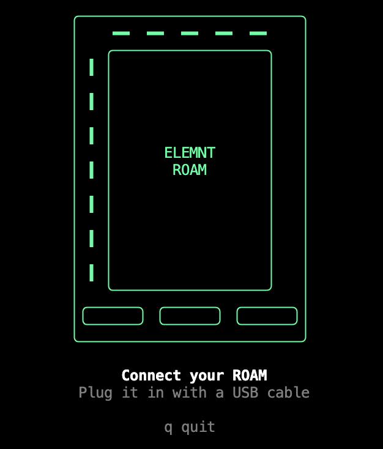
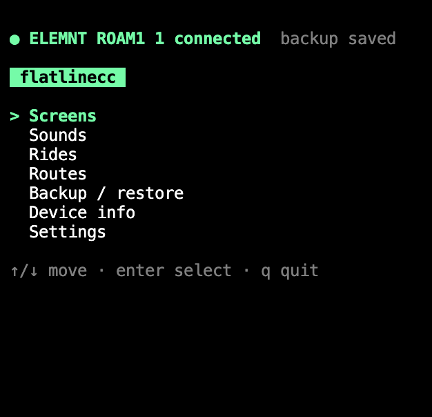
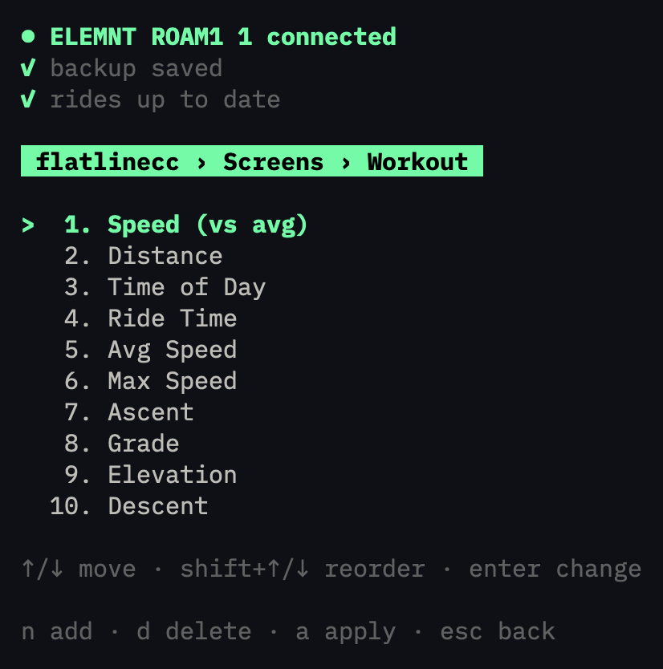

# flatlinecc

A terminal tool to manage a Wahoo ELEMNT ROAM v1 over USB, without the phone app.

<table>
  <tr>
    <td></td>
    <td></td>
    <td></td>
  </tr>
</table>

## Why

I crashed with my ROAM and its Bluetooth stopped working. The device still records rides fine, but without Bluetooth the companion app can't reach it: no screen setup, no route or ride sync. flatlinecc brings that back over the cable.

## Features

Run `flatlinecc` and pick from a menu:

- **Screens**: change, add, remove and reorder data fields on each page
- **Sounds**: mute and buzzer settings
- **Rides**: copy new rides to the data folder. The device is never changed
- **Routes**: sync `.gpx` routes both ways between the data folder and the device. When both have a route with different content (size, then SHA-256), the local one wins; nothing is deleted
- **Backup / restore**: save and restore the device config
- **Device info**
- **Settings**: where the data folder is, and auto sync of rides and routes on connect

Changes to screens and sounds are staged first. Apply shows what changes, then writes the config to the device and restarts the Wahoo app, which takes a few seconds.

Built with Go and [Charm](https://charm.sh) (Bubble Tea, Bubbles, Lip Gloss). Talks to the device through `adb`.

## Install

Requires Go and `adb` (`brew install go android-platform-tools`).

```
go install ./cmd/flatlinecc   # installs to ~/go/bin, add it to PATH
flatlinecc                    # run
flatlinecc -version           # print the version
```

## Connecting the ROAM

The ROAM must authorize your computer for `adb`. This has to be repeated every time you plug it in:

1. Start the adb server once (`adb devices`) so your key exists in `~/.android/adbkey`
2. Unplug the ROAM (keep it on)
3. Press **power** (opens settings), then **power** again (back)
4. Plug in the USB cable

`adb devices -l` should now show `device` instead of `unauthorized`.

## Data folder

Rides, routes and config backups go into one folder, `./data` by default. It's relative to where you run flatlinecc, so don't run it inside another git repo, or set an absolute path in Settings (saved to `~/.config/flatlinecc/config.toml`).

```
data/
  rides/            # .fit files copied from the device
  routes/           # .gpx files, synced both ways
  backups/
    manual/         # made from Backup / restore, kept until you delete them
    session/        # made automatically on connect
```

The session backup is the config as it was when you connected. It's removed when you quit normally, and kept after a crash or a failed apply so you can restore it. Apply and restore stay disabled until it exists.

With auto sync turned on in Settings, rides and routes sync on every connect, as the Rides and Routes screens would. Each is turned on separately, and both are off by default. Since nothing is deleted, a route deleted only from the data folder comes back from the device on the next sync.

## Development

```
go run ./cmd/flatlinecc                    # compile to a temp binary and run
go test -race ./...                        # run tests
go test ./internal/display -fuzz FuzzParse # fuzz a parser (ctrl+c to stop)
go mod tidy                                # sync dependencies with imports
```

Layout:

```
cmd/flatlinecc/      # entry point (package main)
internal/adb/        # device access
internal/config/     # settings
internal/datafields/ # data field and page names
internal/display/    # DISPLAY_CFG page layout (binary)
internal/prefs/      # values in the live config XML
internal/tui/        # menu and screens
internal/wahoo/      # live config, sounds, rides and routes on the device
docs/format.md       # reverse-engineered format notes
```

## Releasing

[Conventional Commits](https://www.conventionalcommits.org) + [SemVer](https://semver.org). [git-cliff](https://git-cliff.org) generates `CHANGELOG.md` and picks the next version from commits since the last tag.

```
git cliff --bump -o CHANGELOG.md
git add CHANGELOG.md
git commit -m "chore(release): prepare for vX.Y.Z"
git tag vX.Y.Z
git push && git push --tags
```

## Status

All menu items work. Open questions about the config format are in [docs/format.md](docs/format.md).

## License

[MIT](LICENSE)

## Credits

Builds on reverse-engineering notes by [Intyre](https://gist.github.com/Intyre).
